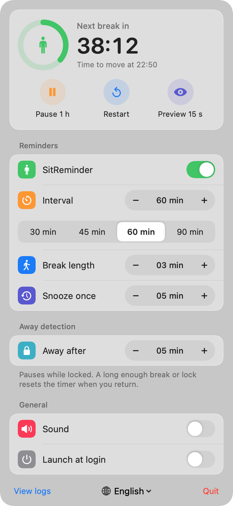
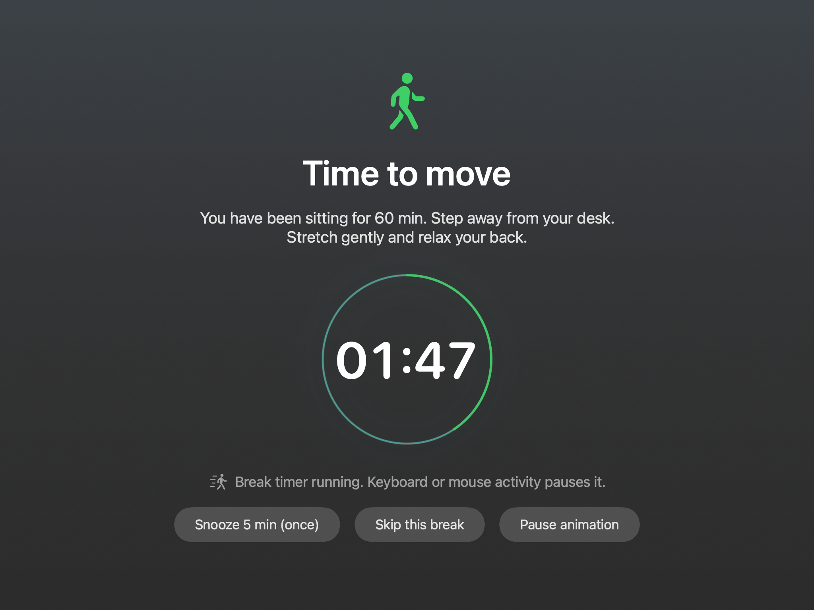

# SitReminder

English | [简体中文](README.md)

A small macOS menu bar app that reminds you to stand up and take a break. It displays a full-screen break overlay on every connected display when your sitting interval ends.



Previews show the layout; the actual glass appearance depends on your desktop and system settings.

## Features

- **Four interface languages:** English, Simplified Chinese, Traditional Chinese and Japanese. The app follows your system language by default. Use the globe menu at the bottom of the control panel to switch instantly. Your choice is remembered, and changing language does not reset the timer. English is the fallback when no preferred language is supported.
- **Frosted-glass controls:** light and dark appearances, centered fixed-width duration controls and evenly sized presets. Reduce Transparency uses solid backgrounds instead.
- **Gentle break animation:** a roughly six-second breathing halo with a separate pause control. It respects Reduce Motion and does not animate the countdown text.
- **Real time away from the keyboard:** the break countdown pauses when keyboard or mouse activity is detected. Pausing the animation does not pause the break timer.
- **Snooze or skip:** snooze once per reminder, or click “Skip this break” twice to confirm an emergency skip.
- **Safe preview:** click “End preview” or press Esc to leave the 15-second preview. Esc does not skip a normal break. The preview uses the same inactivity-based countdown as a normal break.
- **Away and lock detection:** pauses while locked or asleep. A sufficiently long absence starts a fresh sitting cycle when you return.
- **Launch at login:** enabled on first launch; it can be disabled in the control panel. macOS may ask you to allow the login item.
- **Fixed-width menu bar label:** countdown updates do not shift adjacent menu bar items.



## Install or update

Requires **macOS 13 or later**. One universal app supports **Apple silicon and Intel**.

1. Download `SitReminder-<version>.dmg` from [Releases](https://github.com/liyan527/SitReminder/releases/latest).
2. Open the disk image and drag SitReminder to Applications. Alternatively, unzip `SitReminder-<version>.zip` and move `SitReminder.app` to Applications.
3. Open the app, then click its standing-person icon and countdown in the menu bar.

To update, quit SitReminder from its control panel first, replace the app and reopen it. Your settings are retained. The sitting countdown starts a new cycle on launch.

The app is **ad-hoc signed, not notarized by Apple**. If macOS cannot verify the developer, open **System Settings > Privacy & Security** and use **Open Anyway** if available. If you trust this download, you can alternatively remove its quarantine attribute:

```sh
xattr -dr com.apple.quarantine /Applications/SitReminder.app
```

Use the path where you actually installed the app.

## Usage notes

The full-screen overlay temporarily restricts app switching during a normal break; it does not stop or terminate other apps. For a meeting, pause reminders in advance, or use the two-click skip control when needed. “Pause animation” affects only the visual effect.

The globe menu changes the app interface. The name shown by Finder follows the macOS application language. Internal diagnostic log messages remain in Chinese; **View logs** opens `~/Library/Logs/SitReminder.log`.

## Uninstall

Turn off **Launch at login**, choose **Quit**, then move `SitReminder.app` to the Trash.

## Build from source

Install Xcode Command Line Tools with `xcode-select --install`. Full Xcode is not required.

```sh
./build.sh            # Build the universal app in build/SitReminder.app
./build.sh --install  # Build, install in ~/Applications and launch
./build.sh --zip      # Build a ZIP in dist/
./build.sh --dmg      # Build a DMG in dist/
./build.sh --release  # Build both distribution archives
```

`Sources/SitReminder.swift` contains the UI and reminder logic. `Sources/Localization.swift` contains translations and language selection. `Resources/*.lproj/InfoPlist.strings` localizes the application display name. Generated builds and personal validation code are not included in the repository.
