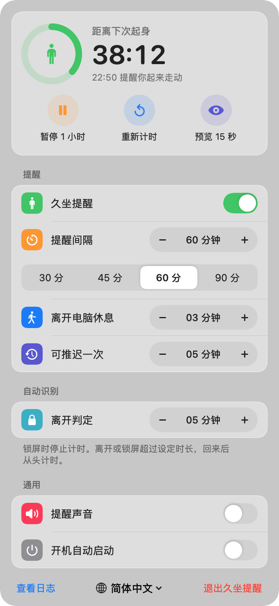
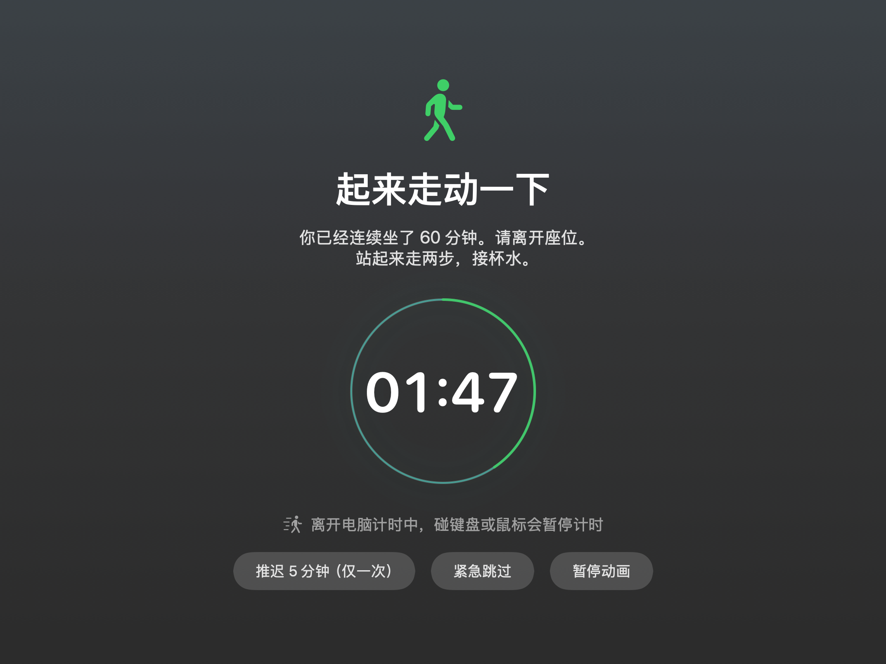

# 久坐提醒 SitReminder

一个 macOS 菜单栏小工具。每坐满设定时间，它会在所有屏幕上弹出全屏提醒，要求你离开电脑走动一会儿。



## 功能

- **全屏强制休息**：时间到后，所有显示器同时显示全屏遮挡。插拔显示器时自动重建遮挡。
- **必须离开电脑**：休息倒计时只在不碰键盘和鼠标时进行。一碰键鼠，计时就暂停。
- **推迟与跳过**：每次提醒可以推迟一次。紧急情况点两次「紧急跳过」退出。
- **自动识别离开**：锁屏和合盖时停止计时。离开或锁屏超过设定时长，回来后从头计时。
- **开机自启**：首次启动时自动开启，可以在面板里关闭。
- **事件日志**：日志写在 `~/Library/Logs/SitReminder.log`，面板里点「查看日志」即可打开。



## 安装

1. 下载 [`releases/SitReminder-1.0.zip`](releases/SitReminder-1.0.zip) 并解压，得到 `SitReminder.app`。
2. 把 `SitReminder.app` 拖到「应用程序」文件夹，然后双击打开。
3. 如果系统提示「无法验证开发者」，按下面任一方式处理：
   - 打开「系统设置 > 隐私与安全性」，在底部点「仍要打开」。
   - 在终端运行 `xattr -dr com.apple.quarantine /Applications/SitReminder.app`，然后重新打开。
4. 启动后，菜单栏右上角会出现一个站立小人图标和倒计时。点击图标即可设置。

出现这个提示，是因为应用只做了本机签名（ad-hoc），没有经过 Apple 公证。

系统要求：macOS 13 或更高版本，支持 Apple 芯片和 Intel 芯片。

## 卸载

1. 点菜单栏图标，在面板里关掉「开机自动启动」。
2. 点面板底部的「退出久坐提醒」。
3. 把「应用程序」里的 `SitReminder.app` 移到废纸篓。

## 从源码构建

只需要 Xcode 命令行工具（`xcode-select --install`），不需要完整的 Xcode。

```sh
./build.sh            # 编译通用版本到 build/SitReminder.app
./build.sh --install  # 编译后安装到 ~/Applications 并启动
./build.sh --zip      # 编译后生成 dist/SitReminder-<版本>.zip
```

## 文件

| 文件 | 说明 |
|---|---|
| `Sources/SitReminder.swift` | 全部源码（SwiftUI + AppKit） |
| `Info.plist` | 应用配置：菜单栏应用，不显示 Dock 图标 |
| `make_icon.swift` | 生成应用图标 |
| `build.sh` | 编译、签名和打包 |
| `releases/` | 已编译的安装包 |
| `docs/` | README 使用的截图 |
